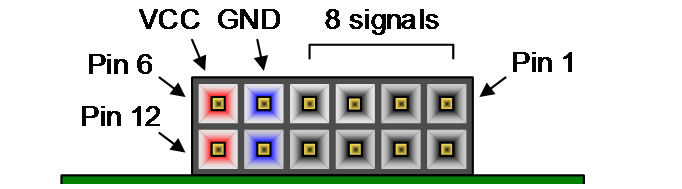

# END TO END CNN ACCELERATOR

## Overview

This repository integrates two existing projects into end-to-end system on the Arty A7-100T:

- [mnist-cnn-accelerator](https://github.com/alexchtst-02/mnist-cnn-accelerator.git): streaming CNN accelerator for 28×28 MNIST digit classification.
- [video-streaming](https://github.com/alexchtst-02/video-streaming.git): OV7670 camera - DDR3 - VGA video pipeline.

The video-streaming design is used together with its processed data path (center ROI, grayscale, 3×3 median filter, thresholding, and nearest-neighbor resize to 28×28). Its 28×28 output is fed to the CNN accelerator running on the 100 MHz board clock through a clock-domain-crossing staging FIFO. The predicted class is displayed on the VGA output as `PREDICTED x` below the ROI, and is also shown in binary on the RGB LEDs.

Verification and detailed discussion of each part are available in the respective repositories above.

## Folder Structure

```
├── 📁 rtl
├── 📁 bit_files
├── 📁 xdc
├── 📄 CITATION
├── 📄 LICENSE
└── 📝 README.md
```

### RTL

All Verilog sources required to build the design, grouped by origin:

| Folder | Content |
| --- | --- |
| `rtl/cnn` | CNN accelerator (conv/pool/FC layers, MAC, buffers, requantization, argmax), taken from mnist-cnn-accelerator |
| `rtl/camera` | OV7670 capture & configuration, DDR3 AXI read/write, async FIFO, median filter, threshold, resize, VGA timing, taken from video-streaming |
| `rtl/integration` | Modules that connect both projects: `cnn_subsystem`, `cnn_stream_bridge` (staging FIFO `vga_clk` → 100 MHz), `cnn_frame_gate`, `argmax_out_cdc`, `text_overlay`, `font_rom_8x8`, plus `frame_processor` and `read_data_path_cnn` adapted from video-streaming |
| `rtl/mem` | CNN weight and bias files loaded with `$readmemh` |

The block design top (`design_cnn_e2e_wrapper`) instantiates `write_data_path`, `read_data_path_cnn`, `frame_manager`, and `cnn_subsystem` together with the Vivado IPs (MIG 7-series, Clocking Wizard, SmartConnect, Processor System Reset, Utility Buffer, JTAG-to-AXI).

#### bit_files

| File | Description |
| --- | --- |
| `design_cnn_e2e_wrapper.bit` | Bitstream for the Arty A7-100T (`xc7a100tcsg324-1`) |
| `design_cnn_e2e_wrapper.ltx` | Debug probe file for Vivado Hardware Manager |

Program the board through Vivado Hardware Manager. After DDR3 calibration (`calib_done`, LD4) the camera image is shown on the VGA monitor, and the prediction appears as `PREDICTED x` on screen and in binary on the blue channel of LD0–LD3 (LD7 lights up once the first prediction is available).

### XDC

The camera and VGA pins are the same in both files. The physical wiring of
the camera and the VGA output on the Pmod connectors is described below.



Each Pmod connector has 12 pins in two rows: pins 1–6 on the top row and pins
7–12 on the bottom row. Looking at the connector from the edge of the board,
**pin 1 (and pin 7) is on the far right**, and **VCC (3.3 V) and GND are the
two pins on the far left**. In the tables below, pin 1–4 means signal pins
JA1–JA4 (top row) and pin 7–10 means signal pins JA7–JA10 (bottom row).

#### OV7670 Camera `[JA and JB]`

The OV7670 module (without FIFO) is wired with jumper cables to **JA** and
**JB**. SCL and SDA use the internal FPGA pull-ups (`PULLTYPE PULLUP` in
the XDC files).

**UPPER JA**

| JA1 | JA2 | JA3 | JA4 | GND | VCC |
| --- | --- | --- | --- | --- | --- |
| SCL (SIOC) | VSYNC | HREF | D7 | GND | 3V3 |

**BOTTOM JA**

| JA7 | JA8 | JA9 | JA10 | GND | VCC |
| --- | --- | --- | --- | --- | --- |
| RESET | D1 | D3 | D5 | – | – |

**UPPER JB**

| JB1 | JB2 | JB3 | JB4 | GND | VCC |
| --- | --- | --- | --- | --- | --- |
| PCLK | SDA (SIOD) | XCLK | D6 | – | – |

**BOTTOM JB**

| JB7 | JB8 | JB9 | JB10 | GND | VCC |
| --- | --- | --- | --- | --- | --- |
| D4 | D2 | D0 | PWDN | – | – |

> The camera is powered from the top row of JA (3V3 and GND). The other
> VCC/GND pins marked "–" are not needed. Do not connect the camera to 5 V.

#### Digilent Pmod VGA `[JC and JD]`

The pin assignment of JC and JD in the XDC files already matches
the **Digilent Pmod VGA**. No jumper cables are needed: plug **Pmod VGA J1
into JC** and **Pmod VGA J2 into JD** directly. VCC and GND are supplied by
the connectors themselves.

**UPPER JC**

| JC1 | JC2 | JC3 | JC4 | GND | VCC |
| --- | --- | --- | --- | --- | --- |
| R0 | R1 | R2 | R3 | GND | VCC |

**BOTTOM JC**

| JC7 | JC8 | JC9 | JC10 | GND | VCC |
| --- | --- | --- | --- | --- | --- |
| B0 | B1 | B2 | B3 | GND | VCC |

**UPPER JD**

| JD1 | JD2 | JD3 | JD4 | GND | VCC |
| --- | --- | --- | --- | --- | --- |
| G0 | G1 | G2 | G3 | GND | VCC |

**BOTTOM JD**

| JD7 | JD8 | JD9 | JD10 | GND | VCC |
| --- | --- | --- | --- | --- | --- |
| HSYNC | VSYNC | – | – | GND | VCC |

## Result

### STA

| WNS | TNS | WHS | THS | TPWS |
| --- | --- | --- | --- | --- |
| +0.597 ns | 0.000 ns | +0.050 ns | 0.000 ns | 0.000 ns |

All user specified timing constraints are met.

| Clock Domain | Frequency | WNS | WHS |
| --- | ---: | ---: | ---: |
| sys_clk_pin (CNN) | 100 MHz | +0.889 ns | +0.050 ns |
| clk_pll_i (MIG / AXI) | 81.25 MHz | +0.597 ns | +0.051 ns |
| clk_out1 (MIG reference) | 200 MHz | +1.691 ns | +0.122 ns |
| clk_out3 (VGA) | 25 MHz | +22.352 ns | +0.055 ns |
| cam_pclk_clk (OV7670) | 25 MHz | +22.596 ns | +0.085 ns |

### Resource Utilization

| Resource | Used | Available | Utilization |
| --- | ---: | ---: | ---: |
| LUT | 31,443 | 63,400 | 49.59% |
| FF | 83,701 | 126,800 | 66.01% |
| BRAM | 63.5 | 135 | 47.04% |
| DSP | 232 | 240 | 96.67% |
| IO | 94 | 210 | 44.76% |
| BUFG | 9 | 32 | 28.13% |
| MMCM | 2 | 6 | 33.33% |
| PLL | 1 | 6 | 16.67% |

### On-Chip Power

| Category | Power | Percentage |
| --- | ---: | ---: |
| Dynamic power | 1.686 W | 94% of total |
| Clocks | 0.164 W | 10% of dynamic |
| Signals | 0.316 W | 19% of dynamic |
| Logic | 0.153 W | 9% of dynamic |
| BRAM | 0.160 W | 9% of dynamic |
| DSP | 0.200 W | 12% of dynamic |
| MMCM | 0.193 W | 11% of dynamic |
| PLL | 0.115 W | 7% of dynamic |
| PHASER | 0.110 W | 7% of dynamic |
| I/O | 0.271 W | 16% of dynamic |
| XADC | 0.004 W | <1% of dynamic |
| Device static power | 0.112 W | 6% of total |
| Total On-Chip Power | 1.798 W |  |

## Contact

For questions, technical discussions, or additional documentation, feel free to contact me at:

**Email:** alexcinatra.htst@gmail.com

I will be happy to provide clarification and assistance where possible.